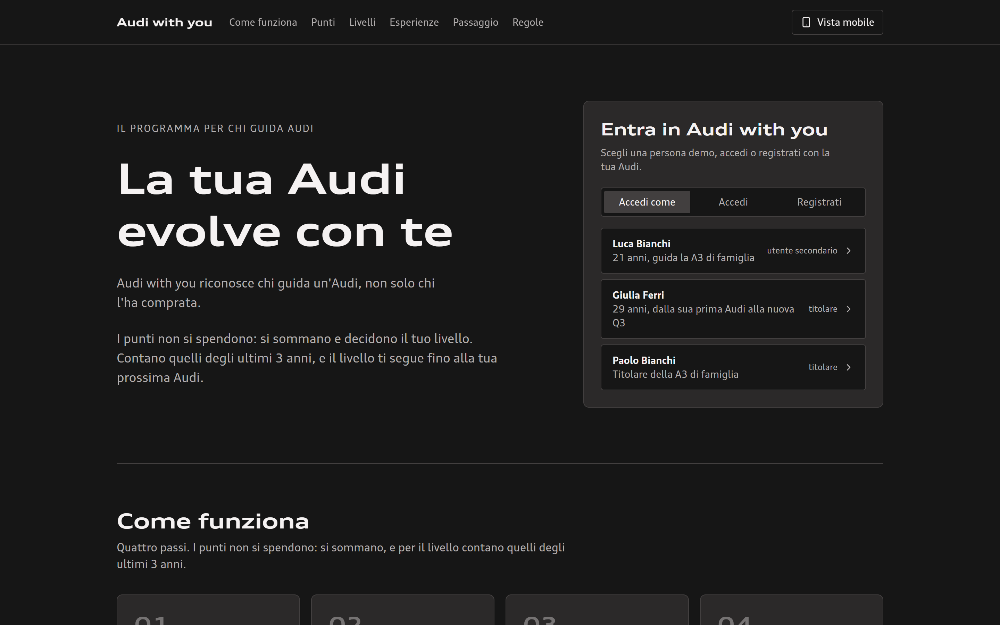
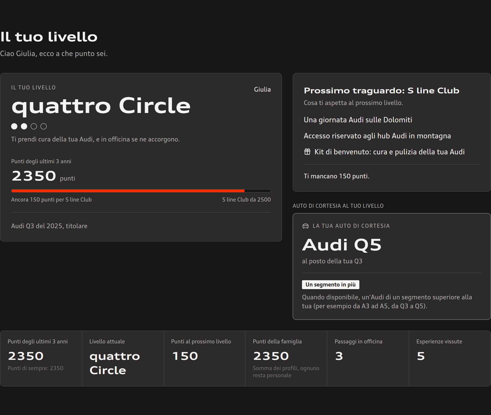
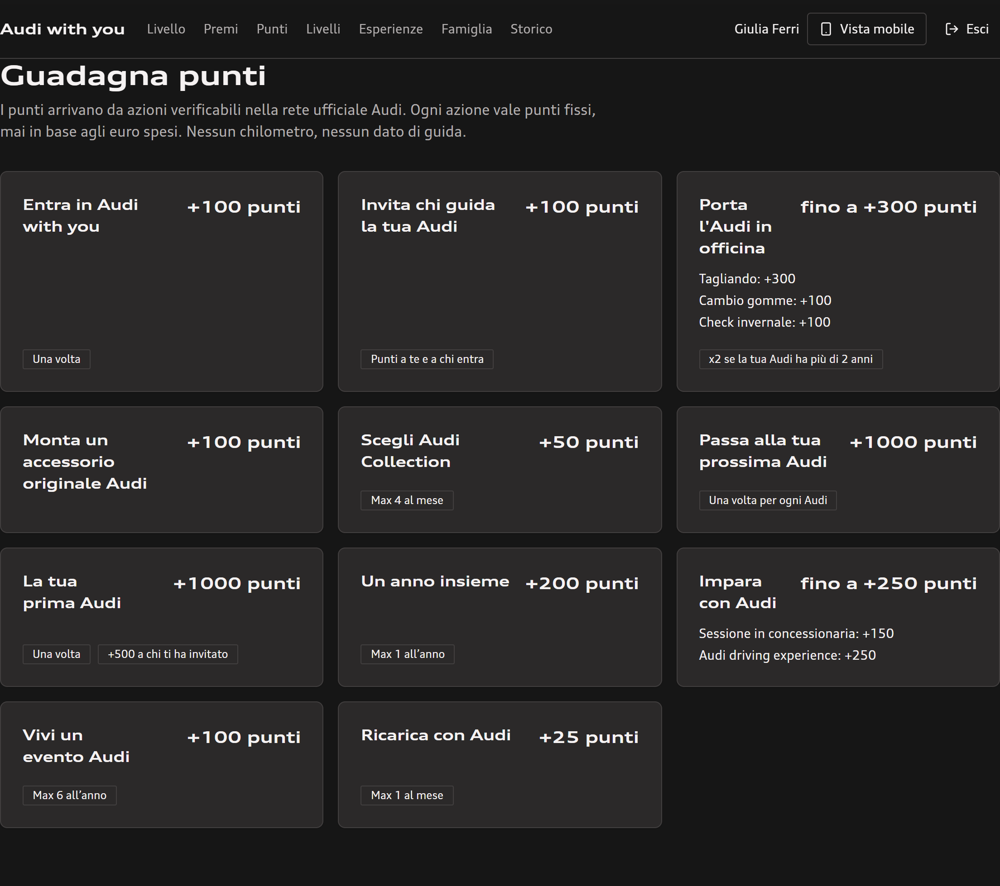
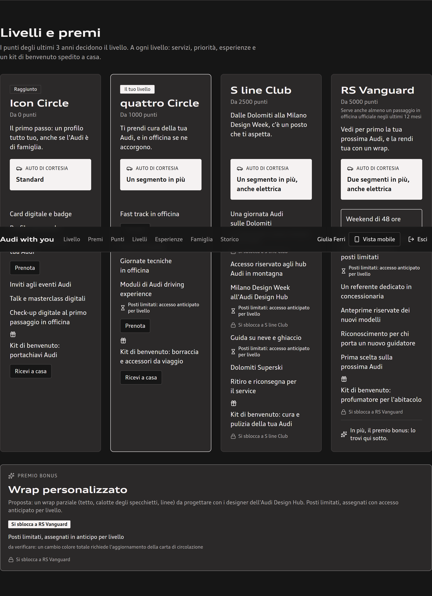
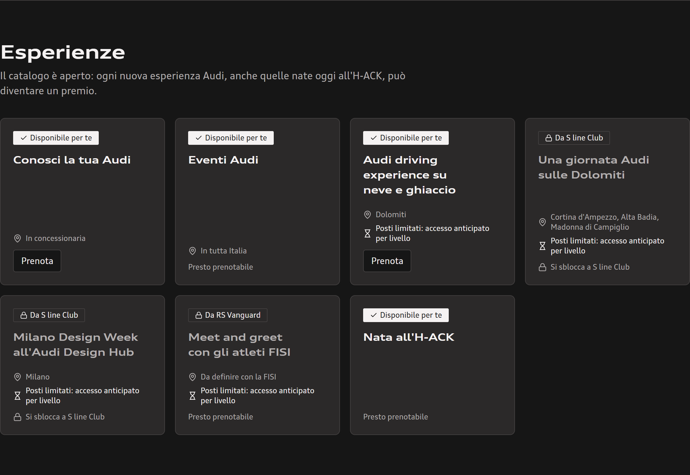
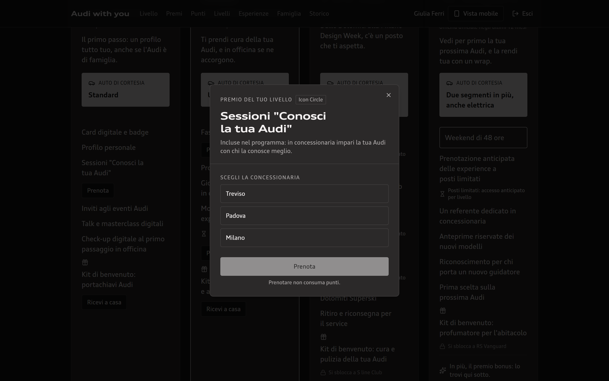
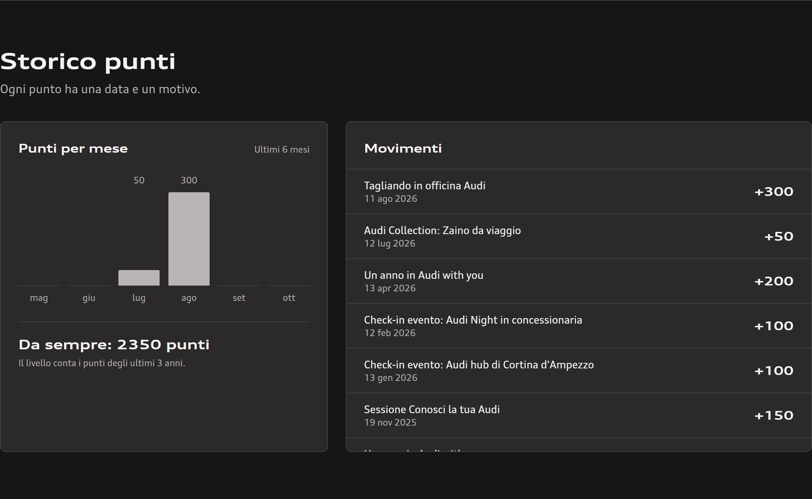
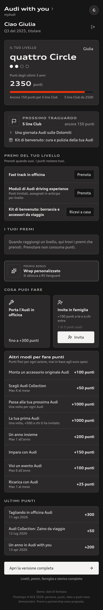

# Audi with you

A loyalty program prototype for Audi Italia, designed and built in one day by a team of eight at the **H-ACK | Co-Design the Future** hackathon (Audi x H-FARM, 10 October 2026).

> **Archived project.** The live demo is no longer maintained: the screenshots below show the finished prototype. The product UI is in **Italian on purpose**, because the brief was for Audi Italia only. All people, points and bookings you see are fictional demo data.

<p align="center">
  
</p>

## The brief

Four briefs were on the table; we chose **Brief 4: how to make the under-35s feel part of the Audi world after the purchase.** The constraints we set ourselves from the brief: no new app (the service lives inside myAudi and on the web), no discounts or promotional mechanics, and nothing that changes the product or the pricing.

## The idea

A lot of young drivers are already in an Audi, just not in their own name: the car, the invitations and the service history belong to a parent. For Audi, that driver does not exist.

**Audi with you** recognises them.

1. **Enter**: the owner invites the people who drive the car, and each of them gets a personal profile.
2. **Look after**: official workshop visits and original accessories earn points.
3. **Take part**: dealership sessions, driving experiences and Audi events earn points.
4. **Level up**: four levels, Icon Circle, quattro Circle, S line Club and RS Vanguard. Only the last 36 months count, and the level follows the person to their first Audi.

Two design choices carry the whole product. **Points are never spent**: they add up and decide the level, so a reward never makes you "poorer". And **rewards are time and access, not discounts**: a fast track in the workshop, a driving day on snow and ice, a day in the Dolomites, the Milan Design Week.

## The prototype

A single-page web app with two views of the same program: the full portal on desktop, and a compact tab meant to live inside the myAudi customizable section on mobile. A small Cloudflare Worker keeps accounts, points, family invitations and reward bookings (QR tickets, kits shipped home, a concierge placeholder).

| | |
|---|---|
|  |  |
| **Your level.** Progress, the next milestone and what comes with it. | **Earn points.** Fixed points per action, never based on money spent. |
|  |  |
| **Tiers and rewards.** What each level unlocks, including loaner car segment and a bonus reward. | **Experiences.** An open catalogue: available now, unlocked at a level, or coming soon. |
|  |  |
| **Booking.** Booking a reward does not consume points. | **History.** Points per month and every movement. |

<p align="center">
  <br>
  <em>The mobile tab, designed to sit inside myAudi.</em>
</p>

## How it was built

- **Frontend**: React 19, TypeScript (strict), Vite, Tailwind CSS 4, shadcn/Radix components, React Router.
- **Backend**: a Cloudflare Worker with a D1 (SQLite) database; migrations in `app/migrations`.
- **Domain logic**: a points and levels engine with its data in `app/src/features/audi-with-you/program.it.json`, kept separate from the UI. A small QR encoder is written in `shared/qr.ts` for booking tickets.
- **Quality**: 192 Vitest tests (engine, program data, compliance rules, components), type checks and CI on every push.
- **Pitch**: a two-voice, five-minute script and the research behind it, all in `pitch/` and `knowledge/`.

## How we worked

AI-first, with a small set of shared rules. Work was split into task files (`tasks/`) with a scope and acceptance criteria, so several people and several agents (Claude Code, Gemini in Antigravity) could build in parallel without stepping on each other. The shared rulebook is `.agents/AGENTS.md`. Research claims were checked against reachable sources before they reached a slide (`knowledge/research/brief4/`).

## Outcome

We were not among the teams selected to pitch to the jury, so the prototype was never presented. We kept it as a worked example of going from a brief to a tested, deployed product in a day.

## Run it locally

```bash
cd app
npm ci
npm run check          # type check + tests
npm run dev            # Vite dev server
```

The Worker needs a D1 database of your own: create one with `wrangler d1 create audi-with-you`, put its id in `app/wrangler.jsonc`, then `npm run db:migrate:local`.

## Repository map

| Path | What |
|---|---|
| `app/` | The prototype: React front end, Worker API, D1 migrations, tests |
| `pitch/` | Pitch script, KPI menu, AI usage log |
| `knowledge/` | Verified Brief 4 research and the decision memo |
| `tasks/` | Task files used to coordinate the team |
| `brand/` | Colour tokens, tone of voice and generation prompts |
| `.agents/` | Shared rules for the AI agents |

## Credits

Alessio, Evelyn, Simone, Valeria, Aurora, Sofi, Nicola and Alberto, with mentors from Audi Italia and Jakala.

## Disclaimer

This is an unofficial team project created during a hackathon. It is not affiliated with, endorsed by or sponsored by AUDI AG, Volkswagen Group Italia or H-FARM. Audi and the four rings are trademarks of AUDI AG. No Audi fonts, logos or organizer material are included in this repository. No licence is granted: all rights reserved by the authors, subject to the hackathon rules.
